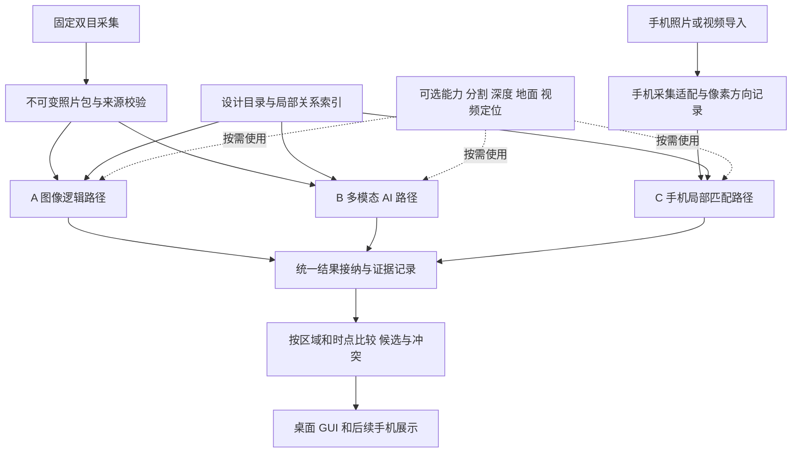

# 管道安装三路径识别与模块化规划

日期：2026-10-31。供现场使用者、远程开发和测试人员共同执行。现有实现基线为 `28ff126`；本次交付为规划文档，下面的新模块、接口和手机流程均尚未实现。

目标是根据现场可见管道的层位、左右关系、粗细和遮挡，辅助判断设计模型中的安装位置。保留原有独立尺寸和就位检查，但不把毫米量测通过作为所有识别路径的共同前提。三条路径共享基础能力，各自形成观察和候选；完成一条路径不是另一条的启动条件。

## 1 三条路径及实施顺序

| 路径 | 现场输入 | 核心判断 | 当前状态和优先级 |
|---|---|---|---|
| A 固定端图像逻辑 | 当前固定双目照片及已有标定、选区和观察侧 | 颜色、可见边界、管段汇聚、条件几何和相对布局 | 已有实现，首先封装、拆分并保持结果一致 |
| B 固定端多模态 AI | 与 A 相同拍摄批次的原始左右图、代表帧和独立的设计资料 | AI 独立发现管道、判断属性及关系，提出模型对应 | 第二阶段接入并与 A 对照，不等待 A 解出断面 |
| C 手机局部匹配 | 手机手持拍摄某一区域的单图、多张图或短视频 | 找出局部可见管道组合在设计中的位置，再检查邻近可见管位 | 第三阶段，最后做四组探索，暂不安排完整手机产品开发 |

神经双目深度、AI 分割、地面估计、视频定位是可选能力，不另算第四条路径，也不是 B/C 必须依赖的 A 产物。“平行”指入口、失败处理和结论独立；受 GPU 或网络资源限制时可以排队，不要求同时运行。

C 的目标包含用户提出的“已有三根及以上管道时尝试自动匹配”。三根是首先验证的启动条件，不是保证唯一匹配的充分条件。重复布局、同径同色、未知观察方向和遮挡都可能保留多个位置候选。

## 2 现有能力与需要拆开的耦合

当前 A 已能从归档照片提出 P004、P008、P009、P011 四个疑似安装管位，GUI 支持照片、列表、断面和 CAD 编号联动，当前方案以黄色显示。该结论来自 2026-10-30 18:32 的历史照片回放；采购规格蓝 50、红 40、白 25 mm 是辅助先验，独立量测直径没有被改写。其余八个管位为未观察到，严格验收状态仍独立保留。数值和来源见 [回放证据](../test_reports/20261031-installation-assist/evidence.json)。

基线回归为 1139 项通过、272 个子测试通过，两项 Tk 环境跳过已独立补跑通过；最后 GUI 回归为 64 项及 5 个子测试通过。这是上一轮实现的验证记录，不是本次规划中新功能的测试成绩，见 [验证记录](../test_reports/20261031-installation-assist/validation-evidence.json)。

现有文件已分开部分功能，但尚未形成三路径架构：

| 位置 | 当前行为 | 规划处理 |
|---|---|---|
| `elevation_auto.py:905`，尤其 947–1021 | 先计算传统深度/连拍，再做局部识别与断面，最后调用辅助匹配 | 保留为 A 的兼容流程；在它上层建立中性调度，B 从原始证据直接进入 |
| `installation_assist.py:86,295` | 从 A 的 `section_evaluation` 提取观察，再用 A 的切线和条件中心求对应 | 初期仍属于 A；随后提取通用赋值和设计关系，保留 A 专用观察适配和评分 |
| `recognition/__init__.py:103` | 插件接口要求 `left/right/depth/calibration/pipe_specs` | 保留为 A 内部检测插件，不冒充能容纳 AI 多图和手机的顶层路径接口 |
| `elevation_dataset.py:382,584` | 现场包强制左右照片和固定双目标定 | 保留旧包校验；另设固定端和手机端输入适配器 |
| `elevation_gui.py:2429,2549` | 单任务 busy、单报告和统一 generation 处理 | 改造计划采用逐路径任务状态；旧响应只丢弃自身，不能清掉新结果 |
| `assist_display.py:17` | 从固定的 `installation_assist` 字段取数据，显示层没有完整来源接纳校验 | 增加统一结果接纳层，再提供按路径选择的展示模型 |

行号以 `28ff126` 为准。拆分不能只移动文件、保留原有隐式依赖，也不应为新路径伪造 A 的断面、右目照片或毫米圆心。

## 3 总体结构

三路共用数据格式和可替换的工具，实现可以不同。相同的公共匹配工具被多路使用时，要记录该依赖；不能把三路一致解释为三个统计独立证据。

建议先保留一个 Python 仓库和本地调用边界，只把需要 GPU 或模型 API 的计算放到可替换的远程服务。暂不把每个模块拆成独立服务，也不提前开发手机原生应用。

## 4 公共模块与 A 路径拆分映射

下列目录是未来职责划分建议，本轮不创建这些代码目录。

| 建议职责 | 当前可复用位置 | 共用范围与保留边界 |
|---|---|---|
| `domain` 数据契约与单位 | `stereo_analyzer.py` 中的相机/管道数据类；各报告字段 | 定义输入、观察、候选和路径结果；相机内参、深度和毫米尺寸可缺省，不能用 0 表示未知 |
| `evidence` 原始资产与派生记录 | `photo_capture.py:364,376`；`elevation_auto.py:925,945,1033` | 复用路径验证、哈希、解码尺寸、发布前复核；原图不变，裁剪、矫正和缩放是有父来源的新资产 |
| `capture` 输入适配器 | `stereo_camera.py`、`elevation_dataset.py`、`temporal_stereo.py` | 现有固定双目适配保持严格左右配对；手机独立支持单图/视频，不使用固定端基线和静态连拍规则 |
| `design` 设计目录和关系索引 | `cad_model.py:879`、`capture_gui.py:441 catalog_from_model`、`dxf_elevation.py:305` | 将无界面 CAD 几何从 GUI 文件迁出；统一单位、设计外径、轴线、模型哈希与稳定管号；手机局部匹配引用全局管号 |
| `geometry` 坐标、投影与姿态 | `image_line_geometry.py`、`camera_view.py`、`epipolar_refinement.py`、`calibration_adapter.py` | 共用纯数学与坐标约定；固定双目标定只绑定对应设备；地面法向和观察侧均记录来源及适用范围 |
| `rendering` 模型视图与可见性 | `elevation_viewer.py`、`stereo_analyzer.py:1163,1233` | GUI 示意图与用于照片匹配的透视模板分开。现 GUI 正交画布投影不能直接当手机图像预测；三角形平均深度的近似渲染也需单独验证 |
| `capabilities` 可选视觉能力 | `capture_quality.py`、`ground_*`、`axial_*`、`pooled_sections.py` 等 | 地面、分割、视差、跟踪等通过适配器提供产物。A 的颜色汇聚可以被调用，但使用者必须声明继承了 A 的观察，不再算独立检出 |
| `matching` 候选组合与关系比较 | `installation_assist.py:52,133,160,199,232,273`、`elevation_registration.py` | 共用设计关系、一对一赋值、多假设和截断标记；每路保留自己的证据适配、评分和阈值。毫米注册、弱透视排列和 AI 关系评分不可混成同一种分数 |
| `decision` 证据与安装记录 | `observation_evidence.py`、`state.py`、现有状态历史 | 区分疑似安装、未观察、冲突、人工确认和严格验收；不把 AI 文本结论直接写成正式尺寸合格 |
| `application` 调度与缓存 | `stereo_analyzer.py:1912`、`elevation_auto.py:905`、GUI worker | 组织任务，不承载检测算法；每路有独立取消、超时、结果发布和缓存 |
| `presentation` 结果展示适配 | `assist_display.py`、`relative_scene.py`、`workflow_status.py`、`elevation_viewer.py` | 共用管号选择、模型高亮、来源和候选表；展示只读已接纳结果，不通过点击生成识别事实 |

必须留在 A 专用策略中的内容包括：A 的边界稳定性判定、左右边界配对、采购直径约束下的 `prior_positions`、当前弱透视评分及严格断面资格。B/C 没有三维圆心时仍能输出图像关系，不能被迫经过这些算法。

设计目录当前适用域仍是平行直管。未来扩展弯头或非平行管时另设几何能力，不能仅通过扩大接口名称宣称支持任意模型。

## 5 统一输入输出契约

### 输入与共用产物

| 对象 | 必要内容 | 可选内容或规则 |
|---|---|---|
| `CaptureBundle` | 包版本、采集会话、来源类型、原始图像/视频哈希、帧与视图 ID、尺寸、拍摄时间及其来源 | 类型区分固定双目、手机单图、手机视频；手机缺少可靠拍摄时间时注明未知，不用上传时间冒充 |
| `ImageTransform` | 原始资产 ID、目标像素空间、处理顺序、裁剪/缩放/方向变换 | 畸变与矫正用配方或映射表引用，不强行压成一个单应矩阵；AI 返回框可映射回原图 |
| `GeometryContext` | 坐标系定义、参数来源和有效范围 | 标定、相机内外参、地面法向、手机重力/轨迹均可缺省；未知姿态、单位或尺度不能默认为已知 |
| `DesignCatalog` | 原始模型哈希、规范化目录哈希、单位、稳定组件 ID、设计管径、轴线和相对布局 | 模型区域和局部组合索引可缓存；设计变更必须显式处理身份迁移，不能沿用同名管号掩盖几何变化 |
| `InspectionIntent` | 本次模型版本、可见/待检查范围、用户约束 | 平行/水平、观察侧、规格和人工提示分别带来源；只检查当前一个选区，不恢复旧 Z01/Z02 多分区工作流 |
| `CapabilityArtifact` | 生产者、版本、参数摘要、父证据、状态和坐标空间 | 分割、深度、地面、轨迹按需生成；A 深度失败不等于照片不能供 B 看图 |

固定端沿用现有原始像素方向政策。手机端保存原始字节，同时创建明确应用 EXIF 方向的显示/分析副本；记录变换，不把自动旋转后的框套回未旋转原图。手机变焦、镜头切换、裁剪和防抖可能改变投影，内参只在其适用帧内使用。

公共缓存采用实际依赖的哈希：掩膜缓存依赖图像与分割器，设计关系依赖模型，候选匹配再依赖观察侧/规格/区域。改变观察侧只需失效受影响的匹配，不应无条件重算像素分析。

### 路径独立输出

统一 `PathResult` 分为以下部分：

| 字段组 | 内容与约束 |
|---|---|
| 任务与来源 | `path_id/run_id/generation/input_fingerprint`，完整输入资产、模型目录、配置、代码和模型版本；API 不能提供权重哈希时记录实际返回模型标识及请求时间 |
| 执行状态 | 排队、运行、完成、部分完成、失败、取消、跳过，与“匹配有歧义”分开 |
| 识别质量 | `quality_decision/eligible_for_advisory/failed_checks`，分别说明是否可用于辅助点亮、适用观察及失败条件；完成任务和来源正确本身不代表识别通过 |
| `observations` | 本路径对象 ID、证据框/掩膜、颜色、粗细、可见边界、质量与遮挡；检出时不必已有模型管号或毫米尺寸 |
| `relations` | 左右、近远、大小、遮挡、轴向等关系；注明是在图像、相机、重力还是 CAD 坐标下，无法判断可缺省 |
| `hypotheses` | 多个完整候选组合，每组一对一映射、未对应观察、候选区域、支持/冲突证据、评分定义和搜索是否截断 |
| `pose` | 未知、局部或完整；列出可观测自由度、尺度来源及可投影范围。只解出断面关系时不填完整相机 XYZ |
| `per_pipe` | 疑似已安装、身份有歧义、未观察到及覆盖范围；其它安装确认和精密验收通过独立证据层表达 |
| 依赖声明 | 使用过哪些共享掩膜、深度、采购规格、地面、匹配器或人工锚点；区分独立识别与查看 A 结果后的复核 |
| 诊断 | 耗时、模型调用次数、可核实费用、拒绝原因、局部失败；无网络和解析失败不能转成“未安装” |

采购规格、设计尺寸、网络估计和独立量测分别使用来源字段。各路径差异分数不是同一量纲，不能直接平均为正确率。AI 输出只允许引用本次输入中存在的资产、模型管号和区域，拒绝重复分配、未知管号和无证据的确定断言。

## 6 A 路径的封装和拆分顺序

先把现有实现整体包成 `FixedImagePath`，保留原报告和 GUI 兼容读取。通过结果适配器生成新契约，不立刻改动旧算法、阈值、标定或历史现场。

随后按顺序抽取纯功能：原始资产校验 → CAD 目录与关系 → 坐标变换 → 候选组合搜索 → 显示模型。每抽取一层，只让 A 切换一处调用并与冻结照片结果比较，避免同时重构和改算法导致无法定位差异。

`installation_assist` 最终拆为 A 观察适配、可复用设计关系/赋值器和 A 评分策略。`assist_prior_geometry` 保留“采购规格条件定位”的名称和证据语义。原有自由求解直径、条件圆心和严格验收不会因模块整理被替换。

## 7 B 路径的固定双目 AI 规划

B 在冻结输入完成后独立启动，不读取 A 的管号建议、历史安装名单或黄色高亮截图。首轮先读取同步左右原图及独立选取的少量代表帧，识别本路对象和关系；再读取完整模型目录、无状态标记的设计图和显式用户约束，提出候选组合。

分割器、神经双目和地面作为可选增强。需要几何计算时，用通过相应校验的标定；只做图像语义判断时，标定或深度不足不应阻断整个 B。左右不同步时不能称双目几何证据，但可按明确降级状态保留单图判断。

结果通过版本化结构返回，原始模型答复归档，解析、边界框和候选管号由本地程序检查。提示词要求描述可见依据，并允许未知或多解；不要求模型凑够四根，不把其自报置信度当作校准概率。

对照阶段可额外发起“解释 A/B 分歧”的任务。它有新的运行 ID，声明看过 A 的答案，不覆盖首轮独立结果。若共用分割器或匹配器，则评估的是不同推理策略，而非整条链完全独立。

## 8 C 路径的手机局部匹配规划

手机路径先用上传/导入照片或短视频进行离线探索；手机型号、系统和是否有 LiDAR 均不作为首版前提。能获取的内参、重力和运动信息作为附加证据，不能从不存在的数据补造固定端标定。

建议流程为：

1. 选用正确设计模型，手机拍摄局部区域；先自动检索区域，范围过大或多解时允许补充模型区域或粗观察侧。
2. 独立检测可见管道，形成数量、粗细、排列、间距比例、遮挡和可见结构的描述。三个以上可区分管道触发重点组合搜索。
3. 在设计中检索局部组合及可能观察侧，按实际可见子集比较投影。暂未安装的设计管道不能在渲染中被默认当成遮挡物。
4. 保留区域、身份和姿态的多个假设。达到区分条件时锁定局部对应；只得到断面对应时明确显示“局部定位”，不宣称完整三维相机位姿。
5. 在已定位且实际拍到的区域内，再判断其余管道是否有可见安装证据。扩展至邻近画面时通过重叠管道或其它结构验证连续性，不能无限传播最初猜测。
6. 多解时请求更有区分力的视图：轻微侧向移动，或带入端部、接头、支架、弯头及周围结构。只有这些结构在设计或额外锚点中有明确对应时，才能直接帮助 CAD 定位；否则仅辅助跨帧关联和理解观察方向。允许少量人工提示帮助消除歧义，并记录其来源。

这里的核心不是“三根管子等于三个已知三维点”。它们的身份、可见轮廓和相机姿态本身尚未确定；只有光滑平行中段时，沿管轴的位置可能不可观测，重复组合也可能位于多个设计区域。移动手机可以增加视差和显露原先遮挡处，原地重复拍同一画面主要改善稳定性。

手机匹配成功也不能把区域外、完全遮挡或低质量处判为未安装。若要提出“疑似缺少”，需要可信的局部定位、预期位置确实落在可检查范围、没有遮挡且有持续的空位证据；首版手机探索仍以正向识别和未知为主。

## 9 三路结果接纳与安装记录

只有资产哈希、模型版本、运行配置和任务 generation 匹配的结果可以进入当前显示。作业输出先写独立文件并原子发布；旧任务完成后仅归档或丢弃自身，不使其它路径和新照片失效。

来源和结构接纳之后，仍按路径检查是否具备辅助点亮资格：A 保持现有边界/布局标准；B 检查图像依据、对象重复、可验证关系及候选歧义；C 还需检查区域对应和局部定位是否足够。质量不通过的观察可以留在诊断中，不能仅因任务完成就成为安装支持。

A/B 同批照片可以直接对照。C 默认是一条不同区域或时点的观察记录：先确认模型版本、区域对应和时间条件，再决定能否比较。手机图像较新不自动获得更高权威，固定机位旧照片也不能覆盖手机的新事实。

对照层建立独立的 `observation_links`，把两路在同一原图上的框、掩膜、轴线和外观做一对一关联。各路对象的 ID、排序和数量可以不同；不能按 S1/S2 的序号，或因为都提议 P008，就认定看见了同一根实物。使用不同代表帧时，先建立有证据的跨帧关联，不能直接比较不同帧的像素框；关联不唯一时显示待核对。

| 情况 | 显示与处理 |
|---|---|
| A/B 对同一观察得到同一管号 | 标记双路径支持，保留各自来源；仍属于辅助判断 |
| 一路有结果，另一路失败/未运行/无法观察 | 保留有证据一路；不把另一路失败作为反对票 |
| 两路给同一根实物不同管号 | 并列方案和冲突原因，不取管号并集点亮 |
| 同一方案把两根实物分配给同一个设计管位 | 结果接纳时拒绝该方案，保留诊断 |
| C 与 A/B 模型或区域不一致 | 不直接比较；分别显示，等待定位/版本对应 |
| 过去看见、当前被遮挡 | 历史记录保留最后见到时间；当前可见性为未知 |
| 有人工确认或严格验收 | 单列来源与适用时点；不由“AI 与 A 一致”自动升级 |

安装记录区分“本次观察”“截至某时的历史确认”和“尺寸/就位验收”。进度统计固定分母与范围，记录疑似、确认、未知的数量；四个候选不自动等于整套工程完成三分之一。后续拆除、模型变更或新反证能形成新事件，不把安装状态实现成只能增加的永久并集。

## 10 GUI 与运行部署

固定端保留熟悉的抓拍、分析准备和⑤保存并评估。未来在结果区增加来源选择“综合 / A 图像逻辑 / B 双目 AI / C 手机观察”，每条路径显示排队、运行、完成、失败和本次照片时间；不新增三套模型窗口。

每次只预览一个路径的一组完整方案，保留照片与模型编号联动。综合页显示可比结果的一致与冲突，并能回到各路原始方案。黄色沿用疑似安装；冲突可以使用独立标记或描边，不能与“未安装”混色。精确尺寸仍在独立页展示，B/C 没有尺寸时显示未提供。

手机首阶段只提供导入入口与结果来源标识；完成探索后再决定 Web 上传页或移动端应用。逻辑上的模型区域用于来源和检索，不恢复用户已取消的多选区并行管理。

本机已检测为 AMD FirePro W7100。已有采集、GUI 和 A 留在本机；依赖 CUDA 的分割/空间模型优先放到独立远程 NVIDIA GPU 环境，通用多图 API 通过可替换适配器接入。原始照片先本地归档，网络失败不影响 A；结果回来前验证输入指纹。服务地址、凭据和费用限制放在运行配置，不写进可分享现场包。

## 11 分阶段任务和交付条件

| 阶段 | 交付内容 | 完成条件 |
|---|---|---|
| P0 当前规划 | 路径定义、模块映射、契约、调研和测试计划 | 三条路径定义与本文件一致；不修改运行算法 |
| P1 固化 A 与协议 | 冻结回放、通用契约、A 包装与兼容适配 | 原现场不重写，候选对应和自由尺寸保持基线一致，旧 GUI/报告仍能读取 |
| P2 提取公共能力 | 证据、设计目录、坐标、候选校验、展示模型和逐路径任务状态 | 公共模块不依赖 A 报告结构；无 GUI、相机或网络也能做离线调用；A 再回放一致 |
| P3 接入 B 的首轮盲判 | 固定端证据包、模型适配器、结构化结果、A/B 比较页 | B 不等 A、不读取 A 答案；失败、迟到、模型变化不会破坏 A；独立人工标签评估收益 |
| P4 B 算法对照 | 按需要比较分割、神经双目、空间 VLM 与简单多图判断 | 分别记录增益、误点亮、耗时和拒绝率，保留有实际收益的组合 |
| P5 手机四组探索 | 手机输入适配、局部组合检索、多解与覆盖显示 | 完成下一节四组试验，形成可用条件与失败案例；再安排手机产品开发 |

前三阶段先建立稳定边界，不同时替换 A 算法。B 的平台/具体模型和远程资源可在 P3 开始前选定，不影响 P1/P2。手机平台和是否使用视频轨迹在 P5 决定，不提前绑定某一型号。

本轮规划不启动以上代码工作；后续实施按阶段提交，提供变更范围、回放结果和可回退的兼容入口。

## 12 测试设计与手机四组探索

### 公共能力和 A 保持一致

采用已有冻结现场与独立合成案例，检查候选赋值、排序、多解、原尺寸、输入哈希和默认选区行为。比较时排除运行耗时、输出时间和新运行 ID 等自然变化。A 的数值、证据语义或候选发生变化，必须作为算法变更解释，不能算作纯模块拆分。

契约测试覆盖未知管号、重复对应、裁剪/缩放/旋转还原、错误单位、模型变更、来源过期、任务取消和迟到结果。专门验证：B 超时仍保留 A；手机没有双目标定仍能进入对应能力；旧手机响应不能覆盖新手机区域。

### A 与 B 的识别质量

使用人工核对过的不同安装组合、不同光照和遮挡条件。按独立拍摄会话或实际布置拆分样本，不能把同一静止场景的十张近重复照片当作十个独立场景。历史四管答案只用于验收，不放入独立推理输入。

补充管号重命名、目录顺序打乱和未知实物的测试，确认对应依赖几何与图像而非记忆编号，也不会强制把模型外实物塞进目录。分别对比无采购先验/有采购先验、纯图像/附加几何，记录共享 A 产物之后独立性发生的变化。跨路径对象合并、拆分或排序改变也需验证 `observation_links`，不能靠模型管号倒推实物关联。

| 指标 | 计算与用途 |
|---|---|
| 管号匹配正确率 | 对已给出对应的现场实物核对管号；同时报告给出对应的覆盖率，防止靠大量拒绝抬高分数 |
| 误点亮率 | 被点亮但经人工真值核对没有相应已安装实物的管位数 / 全部点亮管位数；同时统计点亮了错误身份的情况 |
| 漏检率 | 人工确认在本次可检查范围内且可见的已装管道中，算法没有给出支持的比例；完全不可见单列 |
| 关系正确率 | 分别统计左右、近远/层位、粗细、遮挡关系，不能只用一个总分掩盖某项错误 |
| 多解与稳定性 | Top-1、Top-3 组合命中、未决率、独立重拍身份跳变；同图多次模型调用仅衡量输出稳定性 |
| 成本与时延 | 总评估耗时、模型调用数、实际计费与失败率，和本地 A 并列 |

初次试点先建立真实分布，再冻结业务阈值。来源错绑、模型串用、候选并集误点亮和失败当未安装属于必须阻断的逻辑错误；有限测试中没有发生错误不表示现场错误概率为零。

### C 的四组探索

| 组别 | 现场安排 | 要回答的问题 | 预期行为 |
|---|---|---|---|
| C1 清晰的三根与四根以上 | 选择粗细/间距组合有区别的局部区域，多种手持角度；先单张再短视频 | 三根何时足够找到区域，多一根能改善多少；正确组合是否排名第一 | 布局足够独特时提出对应并给出证据，保持稳定全局管号 |
| C2 重复和对称 | 三根同径、等距、镜像或模型中存在重复子布局；改变观察侧，并加入少于三根的对照 | 是否识别出不可唯一定位，补充哪种视角或结构才能消歧 | 保留多个区域/方案，不因凑够三根就强行锁定 |
| C3 遮挡和反光 | 白管被遮挡、相邻红管接近、部分出框、强反光；侧移后重新拍摄 | 是否分裂同一根或合并两根；新增视角能否显露原不可见管道 | 可见部分形成候选，始终遮住的部分保持未知 |
| C4 扩展和时间变化 | 从已定位区域移动至相邻区；新增/移除管道；混入旧照片和错误模型版本 | 区域连续性、重复计数、历史状态和模型版本是否处理正确 | 只更新有本次证据的范围；拒绝串模型，不把旧识别永久扩散 |

每组输出原始图/视频、人工对应、候选排序、可见范围、失败案例和补拍建议。手机扩展到生产前，以这些结果决定是否需要特征点、支架等辅助结构，或少量人工指定；不在探索前承诺任意三根都能自动定位。

## 13 研究选型及适用范围

检索日期为 2026-10-31。以下是可借鉴的组件或方法，不是已在本项目部署的功能。引用只支持项目公开的能力，三路径组合和阶段顺序是本规划的工程选择。

| 研究或项目 | 已核实能力 | 本规划中的角色 |
|---|---|---|
| [SAM 3 与 SAM 3.1](https://github.com/facebookresearch/sam3) | 3.1 于 2026-03-27 发布；文本/示例分割和视频对象处理，官方提供权重申请和 CUDA 安装路径 | B/C 的可选实例分割；验证白管漏检、相邻红管合并，不直接输出安装身份 |
| [SpatioLM](https://github.com/xiaomi-research/spatio-lm)及[论文](https://arxiv.org/abs/2608.01899) | 2026-08-03 论文，提供空间理解代码与权重，支持图像/多图/视频；官方环境为 Linux、NVIDIA CUDA | B 的自建空间理解候选，和通用多图模型对照；不把多图能力等同于准确使用标定双目 |
| [FoundationStereo](https://github.com/NVlabs/FoundationStereo)与[Fast-FoundationStereo](https://github.com/NVlabs/Fast-FoundationStereo) | CVPR 2025/2026 双目匹配；Fast 官方建议离线追求精度时使用原版，研究和商业使用路径分开 | 可选深度生产者，先用于粗近远关系；不成为独立第三路径或共同入口门槛 |
| [SENSE](https://arxiv.org/abs/2604.15946) | 2026-04-17 论文，将双目特征、语言及视差融合做分割；暂未核实官方代码/权重 | 研究参考，首版不依赖其交付 |
| [CNOS](https://github.com/nv-nguyen/cnos) | CAD 渲染模板、SAM 分割与 DINOv2 特征匹配，官方提供自定义数据入口 | C 的局部组合模板方法参照；重复圆管不能只按单根外观区分 |
| [FoundPose](https://github.com/facebookresearch/foundpose)与[GigaPose](https://github.com/nv-nguyen/gigapose) | ECCV/CVPR 2024 单 RGB 与 CAD 模板的姿态估计；FoundPose 官方发布范围为粗位姿估计 | C 的姿态候选探索；不能把单个完整物体的实验结论推广为无端点平行管必有完整位姿 |
| [MASt3R-SLAM](https://github.com/rmurai0610/MASt3R-SLAM) | CVPR 2025，支持未标定单目输入的 SLAM 与几何恢复 | C 多解时可选移动视频能力；轨迹/几何本身不会给出 CAD 管号 |
| [MapAnything](https://github.com/facebookresearch/map-anything) | 支持图像及可选内参、位姿、深度的几何恢复，官方发布代码和不同许可权重 | 后续共用几何能力候选，不在首阶段增加完整重建负担 |
| [MEP 分割与视觉语言推理](https://researchportal.hkust.edu.hk/en/publications/integrating-hierarchical-segmentation-and-vision-language-reasoni/) | 2025-11，语义分割、几何实例分离及 VLM 投影分析处理复杂遮挡机电点云 | 借鉴模块分工；输入是点云，不等同当前手机单图 |
| [RoboReason](https://arxiv.org/html/2610.33778v1) | 2026-10-24，测试左右、远近和时间排序；分割/检测提示通常改善空间排序，但仍有错误 | 用于设计 B/C 的分项评估，不以模型自报信心或演示图代替现场正确率 |

## 14 后续开发交接

开发首先交付 P1 的兼容包装和基线回放，再做公共工具提取；接口评审重点是“B/C 能否不经过 A 独立工作”以及“手机未知参数能否被正确表达”。测试人员保存旧结果与新结果的差异，不用已有答案给 AI 提示。现场使用者在 P3/P5 提供不同安装组合和少量人工对应，用于独立验证。

后续需要选定但不阻塞当前规划的内容是：B 的服务提供方式及资源预算、可用于盲测的真实场景范围、C 的首个手机采集方式。默认采用可替换模型接口和手机文件导入开展试验。当前既有数据、标定和 GUI 功能继续按 A 使用。
